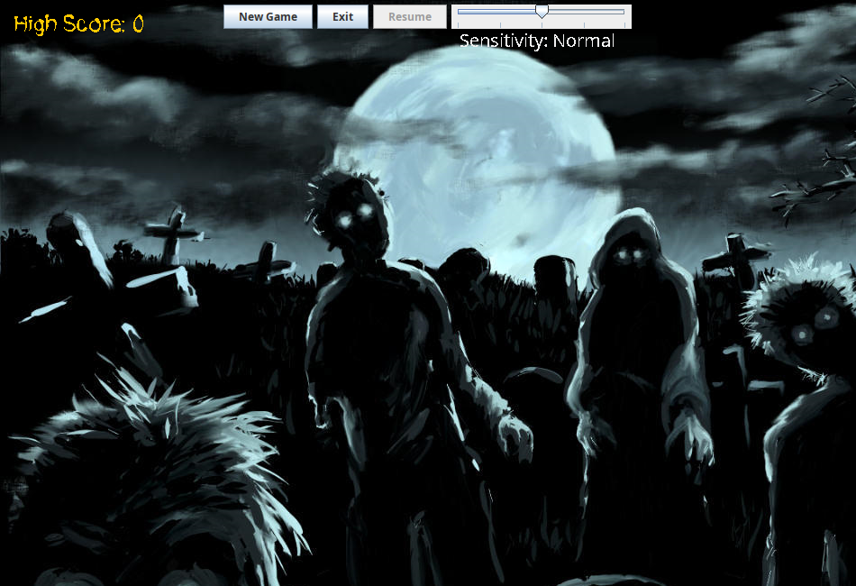
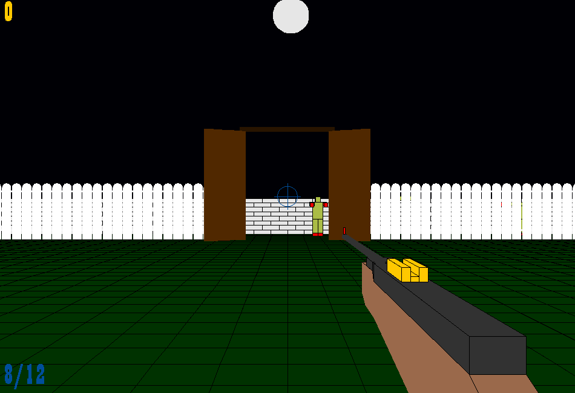

# Zombie Hunt


A pseudo-3D shooter from 12th grade. Night, a fenced arena, doors that open on a timer, and green zombies with red hands. The picture is drawn with matrices and polygons.






JDK 17 or newer, from this folder:

```bash
./build.sh run
```

Or with Docker (browser via noVNC):

```bash
docker build -t zombie-hunt .
docker run --rm -p 6080:6080 zombie-hunt
```

Then open http://localhost:6080/vnc.html

Click the game to capture the mouse and enable sound; Esc releases it. Enter starts a round. WASD moves, the mouse looks, left click shoots, right click is a punch, and R reloads.

Open the existing cheat prompt with F2 and enter `debug mode` to toggle debug mode. While it is on, any mouse click kills a randomly chosen live zombie. Debug mode disables high-score recording for the session.
