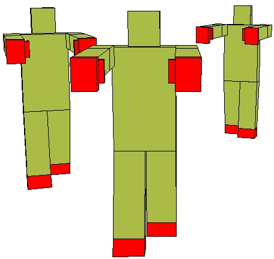
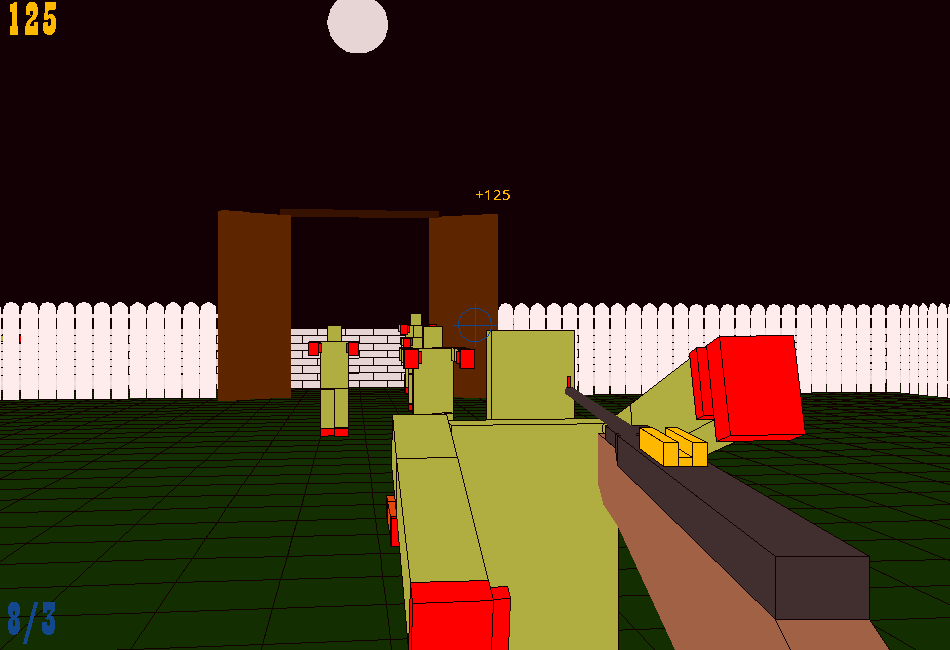

# Zombie Hunt



A pseudo-3D shooter from 12th grade. Night, a fenced arena, doors that open on a timer, and green zombies with red hands. The picture is drawn with matrices and polygons.

## Download

The [latest release](https://github.com/evyatar100/Zombie-Hunt/releases/latest) has self-contained desktop downloads. Java is included.

| Computer | Download |
| --- | --- |
| Mac with Apple Silicon | [macOS arm64 ZIP](https://github.com/evyatar100/Zombie-Hunt/releases/download/v0.1.1/Zombie-Hunt-v0.1.1-macos-arm64.zip) |
| Mac with Intel | [macOS x64 ZIP](https://github.com/evyatar100/Zombie-Hunt/releases/download/v0.1.1/Zombie-Hunt-v0.1.1-macos-x64.zip) |
| Windows x64 | [Windows x64 ZIP](https://github.com/evyatar100/Zombie-Hunt/releases/download/v0.1.1/Zombie-Hunt-v0.1.1-windows-x64.zip) |
| Linux x64 | [Linux x64 tarball](https://github.com/evyatar100/Zombie-Hunt/releases/download/v0.1.1/Zombie-Hunt-v0.1.1-linux-x64.tar.gz) |

Extract the archive before running. On macOS, open `Zombie Hunt.app`; on Windows, run `Zombie Hunt.exe` inside the extracted folder. On Linux, run `Zombie Hunt/bin/Zombie Hunt`. The Mac app is unsigned, so macOS may ask you to approve opening it in System Settings → Privacy & Security. The release includes `SHA256SUMS.txt` to check downloads.

High scores are stored in your user application-data folder: `~/Library/Application Support/Zombie Hunt` on macOS, `%APPDATA%\Zombie Hunt` on Windows, or `$XDG_DATA_HOME/zombie-hunt` (normally `~/.local/share/zombie-hunt`) on Linux. An old `files/scores.dat` is imported when you launch from a checkout.




## Build from source

With JDK 17 or newer, from this folder:

```bash
./build.sh run
```

Or with Docker (browser via noVNC):

```bash
docker build -t zombie-hunt .
docker run --rm -p 6080:6080 zombie-hunt
```

Then open http://localhost:6080/vnc.html

Click the game to capture the mouse and enable sound; Esc releases it. Enter starts a round. WASD moves, the mouse looks, left click shoots, right click is a punch, and R reloads.

Open the existing cheat prompt with F2 and enter `debug mode` to toggle debug mode. While it is on, any mouse click kills a randomly chosen live zombie. Debug mode disables high-score recording for the session.

## Package a native download

Install JDK 21 or newer and Python 3.10 or newer, then run on the target operating system:

```bash
python3 scripts/package.py --version 0.1.1
python3 scripts/verify_package.py path/to/your/archive
```

Set `JAVA_HOME` or pass `--jdk /path/to/jdk` to select the JDK. The archive is written to `build/dist`. `jpackage` builds only for the operating system it runs on; the [native build workflow](.github/workflows/native-release.yml) uses four GitHub Actions runners. A manual workflow run stores test artifacts. Pushing a version tag builds all four packages and attaches them and checksums to a GitHub Release.

The checked-in icons in `packaging/` are generated by `scripts/generate_icons.py` (requires Pillow and macOS `iconutil`).
